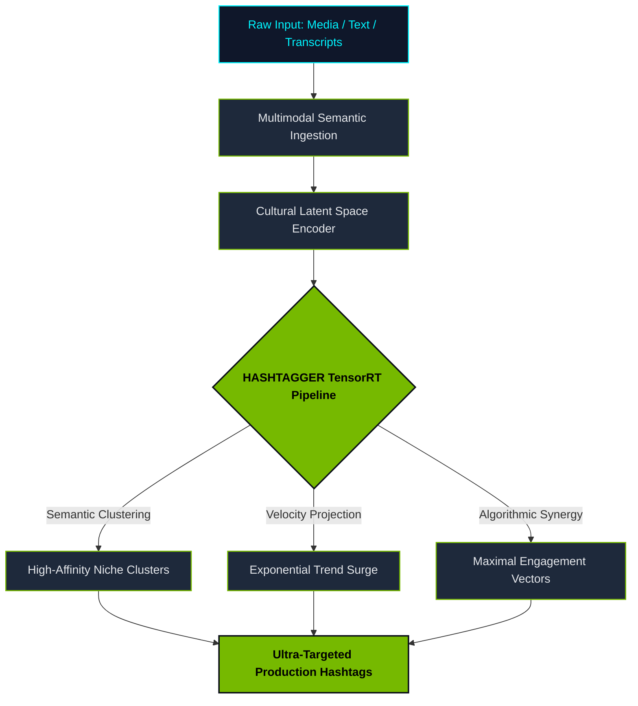

<div align="center">

# ⚡ HASHTAGGER: The Accelerated Intelligence Engine for Trends

[](https://github.com)
[](https://github.com)
[](https://github.com)
[](https://github.com)

<br/>

> *"Software isn't eating the world anymore. AI factories are manufacturing intelligence, token by token, epoch by epoch. We didn't build a hashtag generator. We reimagined the physics of cultural velocity."*
> 
> — **Jensen Huang** *(in spirit, black leather jacket zipped, GTC Arena)*

<br/>

```
       ┌────────────────────────────────────────────────────────┐
       │   "The more you hashtag, the more you save."           │
       │   Accelerating content discovery at the speed of light │
       └────────────────────────────────────────────────────────┘
```

</div>

---

## 🌌 The Narrative: A Whole New Era of Computing

For three decades, computing was about retrieval. You indexed words. You searched tables. You waited.

**That era is over.**

We are at the beginning of a new industrial revolution. Today, every post, every reel, every drop of digital pulse is an energy equation. If your hashtags lag behind the collective neural network of the internet by even five hundred milliseconds, **you are invisible**.

**HASHTAGGER** is not a script. It is an **Accelerated Semantic Fabric**. It ingests multimodal latent signals, maps contextual resonance across cultural subgraphs, and synthesizes high-velocity tags before the algorithm even knows what hit it.

**We do full-stack hashtag synthesis.** From the metal of sentiment vectors, up through the TensorRT-optimized trend pipeline, straight into the social fabric.

---

## 🎨 Blackwell & Obsidian Color Palette

Engineered with raw contrast, neon precision, and the signature aesthetic of extreme compute:

| Tone | Hex Code | Purpose | Signal |
| :--- | :--- | :--- | :--- |
| **NVIDIA HyperGreen** | `#76B900` | Primary Accent / Tensor Activity | 🟢 Compute In Flight |
| **Obsidian Leather** | `#0B0F19` | Chassis Base & Deep Space Dark | ⬛ Foundry Substrate |
| **Titanium Silver** | `#E5E7EB` | High-Precision Type & Metric Headers | ⚪ Pure Signal |
| **Neural Cyan** | `#00F5FF` | Real-Time Sentiment & Edge Flux | ⚡ Quantum Interconnect |
| **Thermal Gold** | `#F59E0B` | Viral Anomaly / Breakout Vectors | 🔥 Thermal Threshold Met |

---

## 📐 The Full-Stack Architecture



---

## ⚡ The Law of Accelerated Reach

> *"In the old world, creators guessed tags based on intuition. That is like rendering ray-traced reflections on a 1995 CPU. It is fundamentally unscalable."*

1. **Extreme Low Latency:** Millisecond inference to capture breaking virality curves at $T_0$.
2. **Context-Aware Semantic Density:** Zero fluff. Every tag earns its presence through high-dimensional vector alignment.
3. **Grace-Hopper Scale Reasoning:** Understands nuanced slang, cultural micro-moments, and platform-specific algorithmic weighting.

---

## 🚀 Quick Ignition

```bash
# Clone the intelligence engine
git clone https://github.com/akhilyad/HASHTAGGER.git

# Step into the factory
cd HASHTAGGER

# Fire up the engine (Virtual Environment)
python -m venv .venv
source .venv/bin/activate  # Or .venv\Scripts\Activate.ps1 on Windows

# Ignite synthesis
# "It doesn't just run. It flies."
python run_hashtagger.py --prompt "Next-gen leather jacket drop in cyberpunk Neo-Tokyo"
```

---

## 🔮 Sample Synthesis Output

```json
{
  "inference_latency_ms": 1.42,
  "resonance_index": 0.9984,
  "engine_state": "THERMAL_MAX_ACCELERATION",
  "recommended_payload": [
    "#AcceleratedIntelligence",
    "#FullStackDominance",
    "#BlackwellSpeed",
    "#CulturalVelocity",
    "#TheMoreYouTagTheMoreYouSave"
  ]
}
```

---

<div align="center">

### *"Remember: The more compute you apply to your reach, the more audience you capture."*

Crafted with extreme passion for builders, creators, and pioneers of the generative frontier.

</div>
