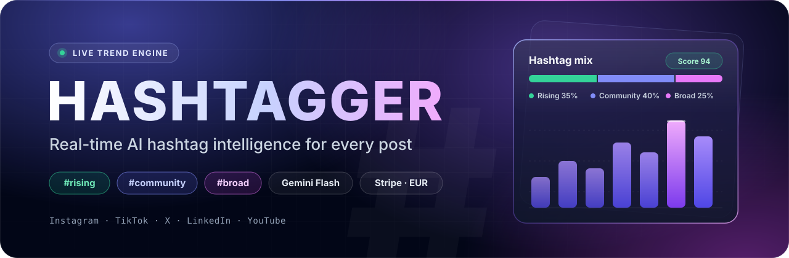
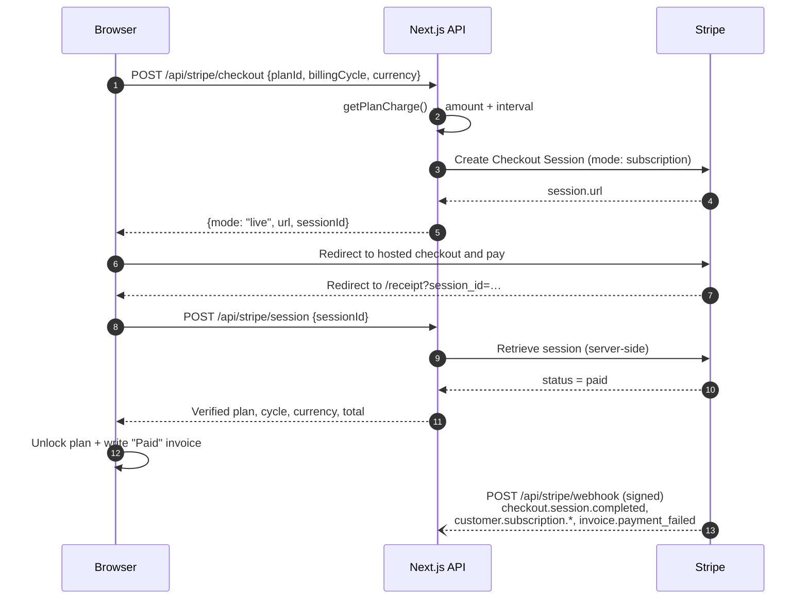

<p align="center">
  
</p>

<p align="center">
  <a href="https://nextjs.org/"></a>
  <a href="https://react.dev/"></a>
  <a href="https://tailwindcss.com/"></a>
  <a href="https://stripe.com/docs/billing/subscriptions/overview"></a>
  <a href="https://ai.google.dev/"></a>
  
</p>

**Hashtagger** reads your caption *and* your photo, then returns a ready-to-post hashtag mix tuned for Instagram, TikTok, X, LinkedIn and YouTube. Each mix is split into rising, community and broad tags, so a post can reach new people and still land with the right audience.

---

## Contents

- [Features](#features)
- [Pricing](#pricing)
- [Payments architecture](#payments-architecture)
- [Getting started](#getting-started)
- [Environment variables](#environment-variables)
- [Testing payments locally](#testing-payments-locally)
- [Deployment](#deployment)
- [Security](#security)
- [Scripts](#scripts)

## Features

| Route | What it does |
| --- | --- |
| `/` | Landing page: hero, live trending-tag marquee, interactive demo with sample creator scenarios, and a bento feature grid. |
| `/live-studio` | The workspace. Paste a caption, optionally upload a photo, pick a platform, and scan. Results come in three groups (**Rising**, **Community**, **Broad**). You can select or deselect tags, copy the post with its tags (or just the tags) in one click, and save reusable hashtag sets. Free users get 3 scans a day. If live AI is unreachable, the page shows sample results under a visible "sample results" notice. |
| `/pricing` | The plan cards, an annual/monthly toggle, a currency selector, a feature comparison matrix, and Stripe checkout. |
| `/receipt` | The return page after checkout. It **verifies the Stripe session on the server** before unlocking a plan, then shows the invoice. Demo checkouts are clearly marked "Demo — no real charge". |
| `/why-it-works` | Explains the 3-part tag mix (trending right now, best topic match, broad popular tags), shows creator results, and gives per-platform guidance on tag count and placement. |

Under the hood:

- **Multimodal analysis:** `POST /api/analyze` sends the caption and image to Google Gemini (`@google/genai`) and returns structured hashtag recommendations. Paid plans turn on live web-search grounding for breaking trends.
- **One shared client store** (`lib/use-hashtagger-store.ts`) holds the plan, billing cycle, currency, credits, invoices and saved sets, and persists them to `localStorage`.
- **Motion and accessibility:** micro-interactions use `motion` and respect `prefers-reduced-motion`. Focus rings are visible and text meets WCAG AA contrast.

## Pricing

EUR is the primary currency. All prices are defined in EUR in `lib/hashtag-data.ts` (`PRICING_PLANS`). `getPlanCharge()` in `lib/currency.ts` is the **only** place where a price is computed. The pricing page, the paywall modal, the checkout route and the receipt all call it, so the price a user sees is always the price they are charged.

| Plan | Monthly billing | Annual billing | Includes |
| --- | --- | --- | --- |
| **Starter Free** | €0 | €0 | 3 AI analyses per day, 2 saved hashtag sets |
| **Creator Pro** | €19 / month | €15 / month, billed **€180 / year** | Unlimited analyses, live breaking trends (web search), unlimited saved sets, CSV export |
| **Growth Agency** | €49 / month | €39 / month, billed **€468 / year** | Everything in Pro, plus priority speed, verified trend sources, CSV and JSON exports, up to 10 seats |

### Supported currencies

Users can switch currency in the navbar, on the pricing page, or inside the paywall.

| Code | Currency | Pro monthly | Pro annual (per month / per year) | Agency monthly | Agency annual (per month / per year) |
| --- | --- | --- | --- | --- | --- |
| **EUR** | Euro (primary) | €19 | €15 / €180 | €49 | €39 / €468 |
| USD | US Dollar | $21 | $16 / $192 | $53 | $42 / $504 |
| GBP | British Pound | £16 | £13 / £156 | £42 | £33 / £396 |
| CAD | Canadian Dollar | CA$28 | CA$22 / CA$264 | CA$73 | CA$58 / CA$696 |
| AUD | Australian Dollar | A$31 | A$25 / A$300 | A$81 | A$64 / A$768 |
| JPY | Japanese Yen | ¥3,135 | ¥2,475 / ¥29,700 | ¥8,085 | ¥6,435 / ¥77,220 |
| CHF | Swiss Franc | CHF 18 | CHF 14 / CHF 168 | CHF 47 | CHF 37 / CHF 444 |
| INR | Indian Rupee | ₹1,710 | ₹1,350 / ₹16,200 | ₹4,410 | ₹3,510 / ₹42,120 |

> [!NOTE]
> Prices in other currencies are converted from EUR using **static rates** (`rateAgainstEUR` in `lib/currency.ts`). They are not live FX rates. The monthly price is rounded to whole units first, and the annual charge is that rounded figure × 12. Stripe bills a **recurring subscription** (monthly or yearly) in the currency the customer picked. Amounts are sent in Stripe minor units, and JPY is handled as zero-decimal.

## Payments architecture

Checkout uses hosted **Stripe Checkout in `subscription` mode**. The browser is never trusted to say that a payment succeeded.



| Endpoint | Purpose |
| --- | --- |
| `POST /api/stripe/checkout` | Validates the plan, cycle and currency, prices the plan with `getPlanCharge()`, and creates the Checkout Session. When demo mode is on, it returns `{mode: "demo", …}` instead. |
| `POST /api/stripe/session` | Retrieves the session from Stripe on the server. It returns `402` unless the session is paid. Only this response can unlock a paid plan. |
| `POST /api/stripe/webhook` | Verifies the Stripe signature with `STRIPE_WEBHOOK_SECRET` and handles subscription lifecycle events. |

**Rules the app enforces:**

- A plan is granted, and a `Paid` invoice written, **only** after `/api/stripe/session` confirms the session is paid.
- In demo mode (no Stripe key in development, `STRIPE_DEMO_MODE=true`, or the static GitHub Pages build), the invoice status is `Demo` and the UI says **"Demo — no real charge"**.
- Any error, 404 or network failure shows an error message and grants nothing.

All route handlers are POST-only. A GET handler would be prerendered and would break the static export.

## Getting started

**Prerequisites:** Node.js 20+ and npm 10+. A [Gemini API key](https://aistudio.google.com/apikey) is needed for live AI results. A Stripe account in test mode and the [Stripe CLI](https://docs.stripe.com/stripe-cli) are optional, for real checkout.

```bash
git clone https://github.com/akhilyad/Hashtagger.git
cd Hashtagger
npm install
cp .env.example .env.local   # then fill in your keys
npm run dev                  # http://localhost:3000
```

The app runs with no keys at all. `/live-studio` falls back to labelled sample results, and checkout runs in demo mode during development.

## Environment variables

Set these in `.env.local` locally, or in your host's secret manager in production. Only `NEXT_PUBLIC_*` variables reach the browser.

| Variable | Scope | Local development | Production |
| --- | --- | --- | --- |
| `GEMINI_API_KEY` | server | Optional. Without it, Live Studio shows sample results. | **Required** for real AI analysis |
| `APP_URL` | server | `http://localhost:3000` (falls back to the request origin if unset) | **Required.** Canonical origin with no trailing slash, used for Stripe success and cancel URLs |
| `STRIPE_SECRET_KEY` | server | `sk_test_…` for real test checkout. Leave empty for demo checkout. | **Required** for payments (`sk_live_…` or a restricted `rk_…` key). Without it, checkout returns a "not configured" error and grants nothing. |
| `STRIPE_WEBHOOK_SECRET` | server | `whsec_…` printed by `stripe listen` | `whsec_…` from Dashboard › Developers › Webhooks |
| `STRIPE_DEMO_MODE` | server | `false` (set `true` to force demo checkout even with a key) | `false` |
| `NEXT_PUBLIC_PAYMENTS_DEMO` | client, build-time | `false` | `false` on a Node server. `true` only for the GitHub Pages static demo. |
| `STRIPE_PRICE_PRO_MONTHLY`, `STRIPE_PRICE_PRO_ANNUAL`, `STRIPE_PRICE_AGENCY_MONTHLY`, `STRIPE_PRICE_AGENCY_ANNUAL` | server | Optional. Leave empty to use inline prices. | Optional. Pre-created **recurring, multi-currency** Price IDs. |
| `NEXT_STANDALONE` | build | `false` | `true` for Docker or Cloud Run (`output: 'standalone'`) |
| `GITHUB_PAGES` | build (CI only) | unset | Set by the Pages workflow. It switches to static export, with `basePath` taken from `GITHUB_REPOSITORY`. |

## Testing payments locally

1. Put a test key in `.env.local`: `STRIPE_SECRET_KEY=sk_test_…`.
2. Forward webhooks to your dev server, then copy the printed `whsec_…` into `STRIPE_WEBHOOK_SECRET`:

   ```bash
   stripe login
   stripe listen --forward-to localhost:3000/api/stripe/webhook
   ```

3. Restart `npm run dev`, open `/pricing`, pick a plan and a currency, and pay with the test card **`4242 4242 4242 4242`** (any future expiry, any CVC, any postcode).
4. You land on `/receipt?session_id=…`. The plan unlocks only after the server confirms the session is paid. Cancel instead, and you return to `/pricing?canceled=true` with nothing granted.

Useful extra test cards: `4000 0025 0000 3155` (3-D Secure) and `4000 0000 0000 9995` (declined).

## Deployment

| | Node server / Cloud Run (full app) | GitHub Pages (static demo) |
| --- | --- | --- |
| Build | `npm run build` (or `NEXT_STANDALONE=true npm run build` for a container) | `.github/workflows/deploy.yml` runs on every push to `main` |
| API routes | ✅ `/api/analyze`, `/api/stripe/*` | ❌ No server, so no API routes |
| AI analysis | ✅ Live Gemini | Sample data, with a visible "sample results" notice |
| Payments | ✅ Real Stripe subscriptions plus webhook | Demo only (`NEXT_PUBLIC_PAYMENTS_DEMO=true`). No real charge, invoices marked `Demo`. |

### Node server / Cloud Run

```bash
npm ci
npm run build
npm start                      # next start on :3000
```

For a self-contained container image, build with `NEXT_STANDALONE=true`. Then copy the static assets next to the server bundle and run it:

```bash
NEXT_STANDALONE=true npm run build
cp -r public .next/standalone/public
cp -r .next/static .next/standalone/.next/static
node .next/standalone/server.js   # honours PORT, e.g. PORT=8080 on Cloud Run
```

Set `APP_URL`, `GEMINI_API_KEY`, `STRIPE_SECRET_KEY` and `STRIPE_WEBHOOK_SECRET` as runtime secrets. Then create a webhook endpoint at `https://<your-domain>/api/stripe/webhook` for `checkout.session.completed`, `customer.subscription.updated`, `customer.subscription.deleted` and `invoice.payment_failed`.

### GitHub Pages

Enable **Settings › Pages › Source: GitHub Actions**. The workflow runs `npm ci`, a typecheck, and a static export with `GITHUB_PAGES=true` and `NEXT_PUBLIC_PAYMENTS_DEMO=true`. The site is served from `/<repo-name>`, and client requests use `apiUrl()` so they respect the base path. Treat this build as a product preview. It is not a working checkout.

## Security

- `.env.local` and every other `.env*` file are gitignored except `.env.example`, which holds only dummy placeholders. Never commit real keys.
- `GEMINI_API_KEY`, `STRIPE_SECRET_KEY` and `STRIPE_WEBHOOK_SECRET` are read only in server route handlers and never use the `NEXT_PUBLIC_` prefix, so they are not shipped to the browser.
- Checkout prices are computed on the server from the plan ID. The client never sends an amount.
- Webhooks are rejected unless the Stripe signature verifies. API errors return generic, user-safe messages.
- Stripe redirect URLs are built from `APP_URL`, never from the request's `Origin` header.

## Scripts

| Script | What it does |
| --- | --- |
| `npm run dev` | Start the dev server on <http://localhost:3000> |
| `npm run build` | Production build (static export when `GITHUB_PAGES=true`) |
| `npm start` | Serve the production build with `next start` |
| `npm run lint` | ESLint 9 flat config (`eslint-config-next` core-web-vitals + TypeScript) |
| `npm run typecheck` | `tsc --noEmit` |
| `npm run clean` | Remove the `.next/` and `out/` build folders |

---

<p align="center"><sub>Built with Next.js, Gemini and Stripe · EUR-first pricing · © Hashtagger</sub></p>
